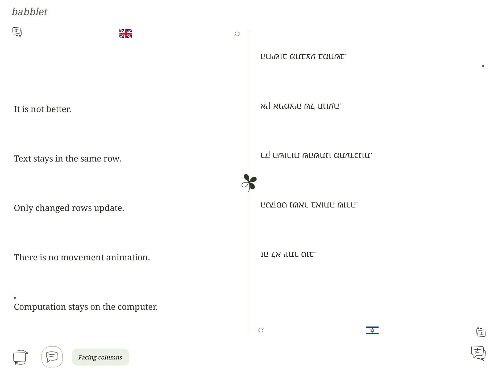

# Babblet

Local, live speech translation for people sharing a table. Speak into a microphone and read the conversation in selected languages on a computer or a reMarkable 2. All speech recognition and translation runs on the computer; the tablet is a lightweight frontend.



## What it does

- Transcribes live microphones with Whisper large-v3-turbo and optionally checks Hebrew with an ivrit.ai specialist.
- Translates into up to six of 38 available languages using local Hy-MT2 Q8 or Q4.
- Shows original speech separately, with language hints linked to display languages by default.
- Keeps fixed FIFO rows: new speech replaces the oldest row without moving its neighbours. A dot marks the newest row; the next replacement fades.
- Offers clean, list, facing-column, stacked and four-panel views. Each reader panel can choose its language and turn 180°, including its controls.
- Shows microphone levels and actual processing activity. Speech-end refinement can join adjacent fragments and refresh their translations.
- Includes a Windows Start menu launcher, tray status and a settings dialog for microphones, installed models, CPU/GPU placement, Hebrew checking, recording and startup preferences.

## Install on Windows

The supported launcher and bundled runtime setup target **Windows x64 with an NVIDIA GPU and Python 3.12**. Development used an RTX 4070 Laptop GPU with 8 GB VRAM and about 32 GB system RAM. CPU processing is selectable, but a CPU-only installation and other operating systems have not been validated. Allow several GB for model weights and more for the Python/CUDA runtime. A reMarkable is optional.

Install Git, Python 3.12, a current NVIDIA driver, and the Microsoft Visual C++ x64 runtime if it is missing. Open PowerShell:

```powershell
git clone https://github.com/domjancik/babblet.git
cd babblet
py -3.12 -m venv .venv
.venv\Scripts\python.exe -m pip install --upgrade pip
.venv\Scripts\python.exe -m pip install torch==2.9.1 --index-url https://download.pytorch.org/whl/cu126
.venv\Scripts\python.exe -m pip install -r requirements-app.lock
.venv\Scripts\python.exe -m pip install --no-deps -e .
.venv\Scripts\python.exe -c "import torch; print('CUDA available:', torch.cuda.is_available())"
```

The CUDA check should report `True` for the default GPU setup. Use the official [PyTorch installation guide](https://pytorch.org/get-started/locally/) if your driver or hardware needs a different build. Babblet uses PyTorch's installed CUDA libraries to support faster-whisper on Windows.

Download the pinned models and llama.cpp runtime once while online:

```powershell
.venv\Scripts\python.exe scripts/setup-models.py
.venv\Scripts\python.exe scripts/setup-hebrew.py
powershell -NoProfile -ExecutionPolicy Bypass -File scripts/install-desktop.ps1
```

The first command installs **Q8**, matching the launcher default, and multilingual Whisper Turbo. To install both translation choices, use `scripts/setup-models.py --all-translation-models` instead. `--benchmark-models` also downloads the optional NLLB benchmark model. These scripts download directly from upstream repositories; inference uses local files after setup. See [model sources and revisions](docs/model-manifest.json) and [third-party notices](THIRD_PARTY_NOTICES.md).

The installer adds **Babblet** to your per-user Start menu. It uses the system-default microphone on a fresh install; no login startup task is added. Keep the checkout in place because the shortcut points to its virtual environment.

## Run and choose preferences

Open **Start → Babblet**. The launcher starts the translation engine and microphone server, opens [the local display](http://127.0.0.1:8090/), and attempts the USB tablet connection. Repeated launches bring the existing launcher forward and reuse healthy services.

Open **Settings…** to choose a microphone (use **Refresh** after plugging one in), installed speech/translation models, Hebrew checking and debug recording. **More preferences** contains CPU/GPU placement, time limits, USB connection at startup and automatic browser opening. **Save and apply** validates the choices and restarts only affected services. Restarting speech clears the current conversation. Closing the launcher window leaves capture running; use its tray icon to reopen it.

In the translation view:

- The language seal opens a full-screen picker; flag changes save immediately. All 38 choices fit the reMarkable screen in portrait and landscape.
- The speech-bubble button shows or hides the original spoken text. Named language columns always target their named language.
- **Readers** cycles through facing columns, stacked panels, four panels and the normal layout. A panel's flag flips it; its language control chooses from the displayed languages. Add choices with the main language picker.
- **Clean** keeps the conversation quiet. Browser ink reveals are subtle; reMarkable updates are static, with no movement animation.
- **Inspect** shows the latest primary/specialist candidates and selection diagnostics. These are heuristics, not calibrated confidence probabilities.

For terminal startup, use two terminals:

```powershell
powershell -NoProfile -File scripts/start-translation.ps1
```

```powershell
powershell -NoProfile -File scripts/start-deck.ps1 -Microphone
```

Pass `-AudioDevice N` to the second script for an explicit device index. List inputs with `.venv\Scripts\python.exe -c "import sounddevice; print(sounddevice.query_devices())"`. The desktop settings interface remembers a microphone by name and host API rather than relying on a stable index.

## reMarkable 2 frontend

Tested on **reMarkable 2 firmware 3.29.0.153**, using XOVI 0.3.3 and AppLoad 0.6.0. The install helpers deliberately refuse a different firmware version. Other versions and reMarkable Paper Pro have not been validated.

Follow the [tablet installation guide](remarkable/INSTALL.md) for developer SSH setup, launcher prerequisites, activation, pairing and deployment. Transport uses an encrypted **USB SSH reverse tunnel** by default. The tablet makes local requests through that tunnel; no inference runs on it and no public LAN service is needed.

After installing: **AppLoad → Reload → Babblet**. Use the rotate button for landscape. On updates, close Babblet and reload it. The desktop launcher can reconnect USB; neither the model server nor the tablet's stock UI needs restarting for ordinary QML updates.

Never publish a paired tablet ZIP: its compiled resources contain a private bearer token. Only an unpaired build is suitable for sharing:

```powershell
.venv\Scripts\python.exe scripts/build-remarkable.py --output artifacts/remarkable/public
```

## Privacy and boundaries

Inference stays on the computer. Model downloads need internet during setup. Browser assets, flags and fonts are local. Speech and translation services bind to loopback; the tablet receives only its bounded presentation through an authenticated gateway.

**Audio recording is off on fresh installs.** Enable it explicitly in desktop Settings or with `--debug-audio artifacts/debug-audio`. Debug mode stores the latest 20 WAV/JSON pairs locally; disabling it leaves existing files in place. [Recording details](docs/DEBUG_AUDIO.md).

Live transcripts are held in bounded memory and overwritten display content is discarded; there is no conversation archive. Language/device preferences and operational logs are saved locally. `config/`, `runtime/`, `models/`, `artifacts/`, recordings, keys, virtual environments and paired bundles are excluded from publication. Do not expose the loopback services directly to a public network.

Model errors remain possible, especially in noisy rooms, short phrases, code-switching and overlapping speech. There is no diarization or guarantee of all-day unattended reliability. [Benchmark results](docs/BENCHMARK.md) describe a small synthetic corpus and its limits, rather than a general model ranking. NLLB is a separate benchmark option, not a live desktop model choice.

## Development and checks

The application lock file includes desktop, tablet-build and test dependencies. The older `requirements.lock` also captures benchmark/fixture tooling; those heavier extras are optional. A model-free test run does not need downloaded weights or CUDA:

```powershell
.venv\Scripts\python.exe -m pytest tests -q --basetemp .cache/pytest-local
node --test tests/page.test.mjs
.venv\Scripts\python.exe scripts/build-remarkable.py
.venv\Scripts\python.exe scripts/check-remarkable-ui.py
.venv\Scripts\python.exe scripts/check-remarkable-network.py
.venv\Scripts\python.exe scripts/check-remarkable-fonts.py
```

Use Node.js 22 or newer for renderer tests. The Qt checks render synthetic content offscreen; they do not claim physical e-ink or touch verification. Microphone settings checks need an available input device. Optional fixture generation and real-model benchmark scripts are documented in [the benchmark notes](docs/BENCHMARK.md); synthetic text-to-speech fixture generation contacts its specified TTS providers.

Source layout: `babblet/` contains the pipeline, APIs and Windows launcher; `babblet/static/` is the browser UI; `remarkable/ui/` is the QML frontend; `scripts/` contains setup and validation helpers; `tests/` contains deterministic regressions. See [speech guidance](docs/SPEECH_LANGUAGES.md), [refinement](docs/REFINEMENT.md), and [Hebrew recognition](docs/HEBREW_RECOGNIZER.md).

## License

Application code: [MIT](LICENSE). Bundled fonts and flags, downloaded models, Qt and other dependencies retain their own licenses; see [THIRD_PARTY_NOTICES.md](THIRD_PARTY_NOTICES.md). This is an independent project, not an official reMarkable application.
